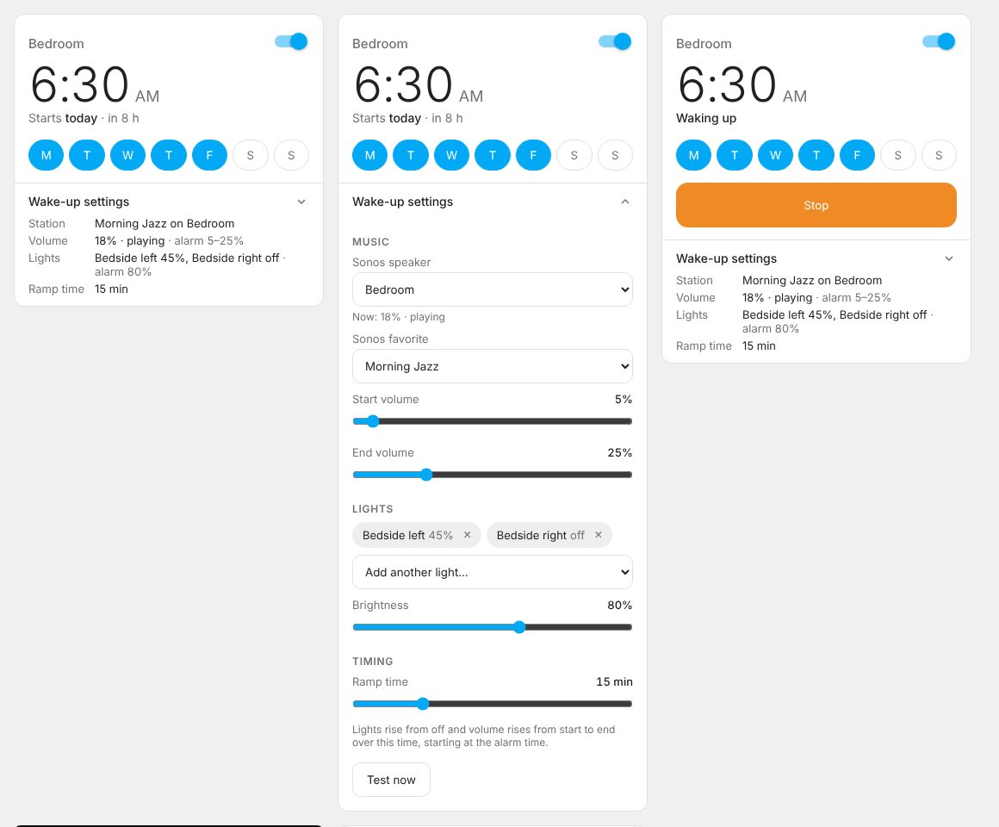

# Sunrise Alarm Clock for Home Assistant

[](https://github.com/hacs/integration)
[](https://github.com/Rogervand/ha-sunrise-alarm/actions/workflows/validate.yml)

A wake-up alarm for Sonos and your lights. At the alarm time your lights rise from off to the brightness you choose while a Sonos favorite starts playing and its volume rises, both over the same ramp time.

Each alarm gets its own dashboard card, so you can put the bedroom alarm on the bedroom dashboard and the kids' alarm on theirs. Everything is set on the card.



## What you can set on the card

| Setting | Notes |
|---|---|
| Alarm time | Tap the time. |
| On / off | Toggle at the top right. |
| Repeat days | Tap day letters. No days selected = rings once, then switches itself off. |
| Sonos speaker | Lists your Sonos speakers. |
| Sonos favorite | Lists your Sonos favorites (see *Requirements*). |
| Start / end volume | Volume rises from start to end over the ramp time. |
| Lights | One or more lights. |
| Brightness | 50–100%. Lights rise from off to this level over the ramp time. |
| Ramp time | 1–60 minutes, shared by lights and volume. |

When collapsed, the card lists the station, the speaker's **current volume** (and whether it's playing), each light's **current brightness**, and the ramp time, next to the alarm's target levels. These update live; current levels also appear in the expanded settings.

While an alarm is waking you, the card shows a **Stop** button: it pauses the music and leaves the lights where they are. Once the ramp finishes the alarm is done; the music keeps playing until you stop it in Sonos. **Test now** runs the wake-up immediately.

## Requirements

- Home Assistant 2025.1 or newer with the **Sonos** integration set up.
- The **Sonos favorites** sensor turned on. Home Assistant creates it disabled: go to **Settings → Devices & services → Sonos → Entities**, find *Sonos favorites*, open it, and turn on **Enabled**. The card shows a reminder until it's on.

## Installation

### HACS

[](https://my.home-assistant.io/redirect/hacs_repository/?owner=Rogervand&repository=ha-sunrise-alarm&category=integration)

1. In HACS, open the menu → **Custom repositories**, add `https://github.com/Rogervand/ha-sunrise-alarm` with type **Integration**, then download **Sunrise Alarm Clock**.
2. Restart Home Assistant.

### Manual

Copy `custom_components/sunrise_alarm` into your `config/custom_components/` folder and restart.

## Adding alarms

1. **Settings → Devices & services → Add integration → Sunrise Alarm Clock.** Give it a name, usually the room (e.g. *Bedroom*). Repeat for each alarm.
2. On the room's dashboard, **Add card → Sunrise Alarm**, and pick that alarm. In YAML:

```yaml
type: custom:sunrise-alarm-card
entity: sensor.bedroom_next_alarm
# name: Bedroom   # optional, overrides the title
```

The card is installed with the integration. It copies the card to `www/sunrise_alarm/` and adds it as a dashboard resource automatically, so it loads even if you open a dashboard while Home Assistant is still starting. (If your dashboard resources are managed in YAML, add `/local/sunrise_alarm/sunrise-alarm-card.js` as a `module` resource yourself.)

## Entities (per alarm)

| Entity | Purpose |
|---|---|
| `time.<alarm>_alarm_time` | Alarm time |
| `switch.<alarm>_alarm` | On/off |
| `sensor.<alarm>_next_alarm` | Next start time; the card reads its settings from here |
| `sensor.<alarm>_status` | `idle` or `waking` |
| `button.<alarm>_stop` | Stop a wake-up in progress |
| `button.<alarm>_test_alarm` | Start now |

## Actions

| Action | Fields |
|---|---|
| `sunrise_alarm.update` | `config_entry_id` plus any of `time`, `days`, `enabled`, `speaker`, `favorite_id`, `favorite_name`, `volume_start`, `volume_end`, `lights`, `brightness`, `ramp_minutes` |
| `sunrise_alarm.stop` | `config_entry_id` |
| `sunrise_alarm.trigger` | `config_entry_id` (start now) |

Events `sunrise_alarm_started` and `sunrise_alarm_stopped` carry `config_entry_id`, `name` and `alarm_time`, e.g. to open the blinds:

```yaml
triggers:
  - trigger: event
    event_type: sunrise_alarm_started
    event_data:
      name: Bedroom
actions:
  - action: cover.open_cover
    target:
      entity_id: cover.bedroom_blinds
```

## Notes

- If a speaker or light fails, the rest of the wake-up still runs; the failure is logged.
- If Home Assistant restarts mid-ramp, the ramp stops and the next alarm is armed.
- Upgrading from 0.x: speaker, favorite, lights and volumes carry over; the old snooze button and per-day switches are removed.

## Development

```bash
pip install -r requirements_test.txt
python -m pytest
```
